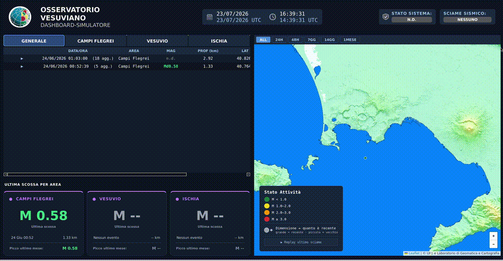

# Sala di Monitoraggio — Dashboard Sismica INGV

Applicazione desktop PyQt6 per il monitoraggio sismico in tempo reale delle aree vulcaniche della Campania — **Campi Flegrei**, **Vesuvio**, **Ischia** — sviluppata per l'Osservatorio Vesuviano (INGV, Istituto Nazionale di Geofisica e Vulcanologia).

Riceve eventi sismici da Kafka o da un'API REST (Serenade), li mostra su una mappa interattiva e in tabelle per zona, calcola lo stato del sistema (QUIETE / N.D. / NORMALE / ATTENZIONE / ALLARME), rileva gli sciami sismici e genera allarmi sonori e visivi per le scosse automatiche più forti.

---

## Indice

## Indice
 
1. [Demo](#demo)
2. [Funzionalità](#funzionalità)
3. [Architettura](#architettura)
4. [Modello dei thread](#modello-dei-thread)
5. [Struttura del progetto](#struttura-del-progetto)
6. [Descrizione dei moduli](#descrizione-dei-moduli)
7. [Sorgenti dati](#sorgenti-dati)
8. [Logica di stato del sistema](#logica-di-stato-del-sistema)
9. [Rilevamento sciami sismici](#rilevamento-sciami-sismici)
10. [Sistema di allarme](#sistema-di-allarme)
11. [Mappa](#mappa)
12. [Replay dell'ultimo sciame](#replay-dellultimo-sciame)
13. [Registrazione e replay dei dati](#registrazione-e-replay-dei-dati)
14. [Interfaccia e scaling](#interfaccia-e-scaling)
15. [Requisiti](#requisiti)
16. [Configurazione](#configurazione-configini)
17. [Avvio](#avvio)

---

## Demo
 
Simulazione di uno sciame sismico ai Campi Flegrei, rigiocato da una registrazione Kafka
(`python main.py --replay`): arrivo degli eventi, aggiornamento della mappa e delle tabelle,
badge di sciame, allarme sopra soglia e replay dello sciame nel riquadro dedicato.



---


## Funzionalità

- **Mappa in tempo reale** (Leaflet, dentro `QWebEngineView`): un pallino per ogni evento sismico, colorato per magnitudo e dimensionato in base a quanto è recente; filtri temporali (`all` di default, poi 24h / 48h / 7gg / 14gg / 1 mese) che agiscono solo sui pallini, mai sulle tabelle.
- **Tabelle log per zona**: una scheda GENERALE e una per ciascuna delle tre zone. Le revisioni dello stesso evento (stesso `event_id`, o stessa area/orario entro pochi secondi) vengono raggruppate in un'unica riga espandibile (▶/▼), con la ★ sulla revisione più recente.
- **Card "ultima scossa per area"**: per ciascuna zona mostra magnitudo, data, profondità dell'ultima scossa e il picco di magnitudo del periodo (dello sciame in corso, se recente, altrimenti dell'ultimo mese).
- **Rilevamento sciami sismici**: doppio binario — un comunicato ufficiale via Kafka (topic `swarms`/`replay.swarms`) ha sempre la priorità quando presente; in sua assenza uno stato euristico locale (`SwarmDetector`) è calcolato dalla frequenza degli eventi nelle ultime 1/6 ore.
- **Replay dell'ultimo sciame**: un riquadro dedicato con mini-mappa riproduce in sequenza le scosse dell'ultimo sciame rilevato, senza interferire con i pallini della mappa live.
- **Sistema di allarme**: soglie di magnitudo (ATTENZIONE ≥ 2.0, ALLARME ≥ 3.0) applicate solo agli eventi automatici (non manuali/revisionati da un operatore), con popup non bloccante (`AlarmDialog`) e avviso sonoro, più una card di zona che resta rossa per un minuto dopo l'evento.
- **Due sorgenti dati intercambiabili**: Kafka o l'API REST Serenade, scelte da `config.ini` senza modificare il codice.
- **Modalità replay per testing**: registrazione dei messaggi Kafka ricevuti (`KafkaRecorder`, con deduplica tramite hash) e riproduzione da file (`--replay`) per sviluppo e demo senza rete verso l'INGV.
- **Interfaccia scalabile**: font e dimensioni dei widget calcolati dinamicamente da risoluzione e DPI dello schermo, pensata per monitor grandi da sala controllo (30"–50").

---

## Architettura

Il progetto segue il pattern **MVC**:

```
┌─────────────┐        ┌───────────────────┐        ┌──────────────┐
│    MODEL    │◄──────►│    CONTROLLER     │◄──────►│     VIEW     │
│ SystemModel │        │ SystemController  │        │ DashboardView│
│             │        │                   │        │ + componenti │
│ • stato     │        │ • riceve i worker │        │ • header     │
│ • log/zona  │        │ • normalizza dati │        │ • tabelle    │
│ • observer  │        │ • pilota mappa/UI │        │ • mappa      │
└─────────────┘        └───────────────────┘        └──────────────┘
                                │
                  ┌─────────────┼──────────────┐
                  ▼             ▼              ▼
            AudioService   MapService   SwarmDetector /
                                         AlarmService /
                                         KafkaRecorder
```

- **Model** (`models/system_model.py`) è l'**unico** punto che decide lo stato del sistema: né la View né il Controller lo ricalcolano autonomamente. Usa il pattern Observer (`add_observer`/`notify_observers`) per notificare la View quando qualcosa cambia — `DashboardView` si registra come observer e implementa `update_ui()`.
- **Controller** (`controllers/system_controller.py`) riceve i segnali Qt dai worker dati (Kafka o Serenade), normalizza i messaggi in un formato interno comune, aggiorna il Model, la mappa, le tabelle, le card di zona, i badge di sciame e gli allarmi.
- **View** (`views/`) è passiva: espone metodi (`update_zone_cards`, `update_swarm_state`, `update_logs`, ecc.) che il Controller chiama; non contiene logica di dominio.

---

## Modello dei thread

L'applicazione usa **tre thread separati** oltre al thread principale Qt, per evitare che la ricezione dati o il server della mappa blocchino l'interfaccia:

```
MAIN THREAD (Qt / GUI)
├── QApplication, DashboardView, SystemController, SystemModel
├── Gestisce click, aggiornamento widget, popup di allarme
└── Riceve segnali Qt (pyqtSignal) dagli altri thread — mai chiamate dirette

DATA THREAD (QThread) — Kafka o Serenade, mai entrambi insieme
├── KafkaWorker.run(): connessione a kafkacluster.int.ov.ingv.it:9095,
│   ascolto bloccante su più topic, emette message_received / swarm_message_received
│   oppure
├── SerenadeWorker.run(): event loop asyncio dedicato, polling periodico
│   (ogni "refresh" secondi) dell'endpoint REST, emette message_received
│   oppure
└── ReplayFileWorker.run() (con --replay): legge riga per riga i file
    .jsonl registrati ed emette gli stessi segnali con un ritardo simulato

BACKGROUND THREAD (daemon, threading.Thread)
└── avvia_server(): server HTTP locale sulla porta 8000, serve servers/servermap/map.html
    alla QWebEngineView (che non può caricare file:// per motivi di sicurezza browser)
```

La comunicazione tra il data thread e il main thread avviene **solo** tramite `pyqtSignal`/slot Qt (`message_received`, `swarm_message_received`) — questo è il meccanismo che rende sicuro l'accesso concorrente: `on_kafka_message`/`on_serenade_message` nel Controller vengono eseguiti nel thread del Controller (il main thread), non nel thread dati, anche se il segnale è stato emesso altrove.

Alla chiusura dell'app (`app.aboutToQuit`), `main.py` ferma ordinatamente il worker (`data_worker.stop()`) e il thread (`requestInterruption()`, `quit()`, `wait()`).

---

## Struttura del progetto

```
dashboardpy/
├── main.py                       # entry point, gestisce anche --replay
├── config.ini                    # sorgente dati, Kafka, Serenade, filtri mappa
├── replay_worker.py              # ReplayFileWorker: replay da PIÙ file registrati
│                                 #   (è quello usato da main.py --replay)
│
├── controllers/
│   └── system_controller.py      # tutta la logica applicativa (vedi sopra)
│
├── models/
│   └── system_model.py           # stato di sistema, log per zona, observer
│
├── services/
│   ├── audio_service.py          # allarme sonoro (nativo / PowerShell / aplay)
│   ├── map_service.py            # ponte Python → JS verso la mappa
│   ├── swarm_detector.py         # euristica di rilevamento sciame
│   ├── alarm_service.py          # soglie e distinzione automatico/manuale
│   ├── kafka_recorder.py         # registrazione messaggi Kafka con deduplica
│   ├── kafka_replay_worker.py    # replay da un SINGOLO file (variante non usata
│   │                             #   da main.py, tenuta per test mirati)
│   └── alarm_dec.wav             # suono dell'allarme
│
├── servers/
│   ├── thread.py                 # crea il worker dati (Kafka/Serenade) da
│   │                             #   config.ini e carica i filtri mappa
│   ├── serverkafka/
│   │   └── kafka.py              # KafkaWorker: connessione reale a Kafka (ovsvmlib)
│   ├── serenade/
│   │   └── serenade.py           # SerenadeWorker: polling REST asincrono (httpx)
│   └── servermap/
│       ├── server.py             # server HTTP locale (porta 8000)
│       ├── map_config.json       # provider tile (osm/ingv) e livelli di zoom
│       └── map.html              # mappa Leaflet + JS di interazione
│
├── views/
│   ├── dashboard_view.py         # QMainWindow, orchestrazione dei componenti
│   ├── dialogs.py                # AlarmDialog
│   └── components/
│       ├── header.py             # logo, titolo, data/ora, stato sistema, stato sciame
│       ├── tabs.py               # tabelle log + card "ultima scossa per area"
│       └── map_widget.py         # wrapper della QWebEngineView + barra filtri
│
├── utils/
│   ├── helpers.py                # raggruppamento eventi, parsing date, scala UI
│   └── config_loader.py          # lettura config.ini
│
├── icons/                        # loghi/icone header (opzionali: fallback a emoji)
│
└── test_data/
    ├── fix_topics.py             # script una tantum per riparare vecchie registrazioni
    └── kafka_recordings/         # file .jsonl usati dalla modalità --replay
```

---

## Descrizione dei moduli

### `controllers/system_controller.py`
Principali responsabilità:
- `on_kafka_message` / `on_serenade_message`: ricevono i dati grezzi, li normalizzano in un `log_entry` comune, li salvano nel Model (`add_log`/`add_log_batch`), aggiornano mappa, tabelle, card di zona, sciami e — se serve — fanno scattare l'allarme.
- `_normalizza_zona_kafka`: mappa il codice area grezzo (`vesuvio`, `flegrei`, `ischia`) al nome zona interno.
- `_chiave_evento_mappa` / `_aggiorna_evento_mappa`: deduplicano gli eventi sulla mappa (per `event_id`, o per area + prossimità temporale) così le revisioni della stessa scossa aggiornano lo stesso pallino invece di crearne uno nuovo.
- `controlla_quiete` (timer ogni 30s): riporta il sistema a QUIETE dopo 15 minuti di silenzio e spegne le card rosse dopo 1 minuto dall'allarme.
- `_update_swarm_widget` / `on_kafka_swarm_message`: gestiscono lo stato sciame, dando priorità al comunicato ufficiale Kafka sull'euristica locale.
- `on_replay_sciame_richiesto` / `_avvia_replay_ultimo_sciame`: costruiscono l'elenco delle scosse dell'ultimo sciame e lo inviano al riquadro di replay sulla mappa.
- `_trigger_alarm`: riproduce il suono, accende la card rossa, mostra il popup `AlarmDialog`.

### `models/system_model.py`
Unico responsabile dello stato (`SystemStatus`: QUIETE / N.D. / NORMALE / ATTENZIONE / ALLARME), con soglie centralizzate (`SOGLIA_ALLARME = 3.0`, `SOGLIA_ATTENZIONE = 2.0`). Due modalità di calcolo dello stato, entrambe presenti e usate:
- `aggiorna_stato_da_evento_ricevuto` — **modalità arrivo**: segue l'ultimo messaggio ricevuto, indipendentemente dalla data. Usata da Kafka (`_use_arrival_order_for_status = True`).
- `aggiorna_stato_da_logs` — **modalità cronologica**: segue l'evento con la data più recente tra i log. Usata sempre da Serenade.

`is_manuale()` distingue eventi automatici da quelli rivisti da un operatore, guardando il campo `author` (tutto ciò che non contiene `"earthworm"` è considerato manuale).

### `services/`
- **`audio_service.py`**: rileva l'ambiente (WSL vs Linux nativo) e sceglie il metodo di riproduzione: `QSoundEffect` su Linux nativo (con fallback `aplay`), PowerShell (`Media.SoundPlayer`) su WSL.
- **`map_service.py`**: unico punto che genera le chiamate `runJavaScript()` verso la mappa; mette in coda gli aggiornamenti se la mappa non è ancora pronta (`process_pending`).
- **`swarm_detector.py`**: euristica basata su soglie di eventi confermati (esclusi quelli di tipo `"trigger"`) in finestre di 1h/6h, con stato persistito (`previous_state`) per riconoscere la transizione a "sciame terminato".
- **`alarm_service.py`**: `should_alarm()` — vero solo se l'evento è automatico e la magnitudo supera la soglia (3.0 di default).
- **`kafka_recorder.py`**: salva i messaggi Kafka su file `.jsonl`, calcolando un hash (SHA1, senza il timestamp di arrivo) per non registrare due volte lo stesso messaggio tra run diversi. Vedi [Registrazione e replay dei dati](#registrazione-e-replay-dei-dati).

### `servers/`
- **`thread.py`** è il modulo effettivamente usato da `main.py`: legge `config.ini` e crea il `QThread` + il worker giusto (`KafkaWorker` o `SerenadeWorker`), oltre a caricare i filtri mappa.
- **`serverkafka/kafka.py`**: il `KafkaWorker` reale, basato sulla libreria interna INGV `ovsvmlib`; broker (`kafkacluster.int.ov.ingv.it:9095`) e topic sono definiti direttamente nel worker, non in `config.ini`.
- **`serenade/serenade.py`**: il `SerenadeWorker` reale, con un event loop `asyncio` dedicato dentro il thread Qt, polling via `httpx.AsyncClient`.
- **`servermap/server.py`**: `http.server.SimpleHTTPRequestHandler` minimale, in un thread daemon, serve `map.html` alla `QWebEngineView` locale.

### `views/`
- **`dashboard_view.py`**: finestra principale, calcola la scala UI all'avvio (`compute_ui_scale`), compone header/tabelle/mappa, gestisce i timer (orologio, titolo finestra, coda aggiornamenti mappa) e implementa `update_ui()` come observer del Model.
- **`components/header.py`**: logo, titoli, data locale + data UTC, orologio locale + UTC, badge "STATO SISTEMA" (icona a scudo disegnata a runtime con `QPainter`) e badge "SCIAME SISMICO".
- **`components/tabs.py`**: le 4 tabelle log (con raggruppamento revisioni) e le 3 card di zona (magnitudo, data, profondità, picco, badge allarme/sciame).
- **`components/map_widget.py`**: incapsula la `QWebEngineView`, la barra dei pulsanti filtro (generata da `config.ini`), e `MapPage` — una `QWebEnginePage` custom che intercetta i link `app://tab/...` e `app://replay/...` generati dal JS della mappa, trasformandoli in segnali Qt invece di farli navigare davvero.
- **`dialogs.py`**: `AlarmDialog`, popup non bloccante (`setModal(False)`) con testo HTML e stile scalabile.

### `utils/helpers.py`
Funzioni condivise da Controller, Model e View, così la regola di ordinamento/raggruppamento è unica in tutto il progetto:
- `chiave_data`: normalizza `"T"` in spazio per un confronto stringa corretto delle date.
- `raggruppa_per_evento`: raggruppa i log per `event_id`, sceglie come "rappresentante" l'ultima revisione con magnitudo nota.
- `seleziona_ultima_scossa`: individua l'evento più recente raggruppando le revisioni ravvicinate entro una tolleranza (2s di default) — usato per lo stato di sistema quando `event_id` non è affidabile.
- `parse_event_datetime`: parsing tollerante di date con/senza millisecondi, con `T` o spazio.
- `compute_ui_scale`: fattore di scala UI da larghezza schermo, DPI e device pixel ratio.

---

## Sorgenti dati

| **Kafka** | `KafkaWorker` | libreria interna `ovsvmlib` (`BaseWorker`) | Topic: `replay.events`, `strongmotions`, `eew_events`, `replay.swarms` (smistati per nome: `swarms` va sul segnale sciami, il resto sugli eventi) |

| **Serenade** | `SerenadeWorker` | REST, `httpx.AsyncClient`, polling ogni `refresh` secondi | Interroga `base_url + endpoint` con i parametri `date`/`level` da `config.ini` |

La sorgente attiva si sceglie in `config.ini`, sezione `[DATA]` → `source = kafka` oppure `source = serenade`. Le due sorgenti non sono mai attive insieme.

---

## Logica di stato del sistema

Lo stato (`SystemStatus`) è calcolato **esclusivamente** dal Model, con soglie centralizzate in `SystemModel.SOGLIA_ALLARME`/`SOGLIA_ATTENZIONE`.

La differenza tra Kafka e Serenade nel criterio di selezione dell'evento (ordine di **arrivo** vs ordine **cronologico**) è intenzionale, non un bug: le due sorgenti consegnano i dati in modo diverso. Kafka è un flusso in cui l'ordine di arrivo *è* l'informazione (comprese le revisioni che arrivano dopo), mentre Serenade restituisce a ogni polling un insieme di eventi in cui conta la data.

Il timer `controlla_quiete` (ogni 30s, nel Controller) riporta lo stato a QUIETE dopo `QUIETE_DOPO_SECONDI` (15 minuti) di silenzio, misurati sull'orologio di **arrivo** dei messaggi — non sulla data dell'evento, per non entrare subito in quiete quando si rigioca un replay di dati vecchi.

---

## Rilevamento sciami sismici

Due binari, con priorità netta:

1. **Comunicato ufficiale** (Kafka, topic `swarms`): se presente per una zona, il badge mostra sempre e solo questo, con etichette `SCIAME INIZIATO` / `SCIAME IN CORSO` / `SCIAME TERMINATO` a seconda del tipo di comunicato (`news`/altro/`end`).
2. **Euristica locale** (`SwarmDetector`, sempre attiva in sottofondo su tutte e tre le zone): conta gli eventi "confermati" (esclude quelli di tipo `"trigger"`) nell'ultima ora e nelle ultime 6 ore — soglie: ≥3 in 1h → INIZIATO, ≥5 in 6h → IN CORSO, sotto soglia dopo essere stati attivi → TERMINATO, altrimenti NESSUNO.

Il picco di magnitudo dello sciame (mostrato nella card di zona) viene aggiornato via `update_zone_swarm_peak`, conservando il valore più alto se più comunicati arrivano per lo stesso periodo.

---

## Sistema di allarme

- Soglie (in `alarm_service.py` e `system_model.py`, tenute allineate manualmente): ATTENZIONE ≥ 2.0, ALLARME ≥ 3.0.
- Scatta **solo** per eventi automatici (`is_manuale()` falso) con `event_id` non già allarmato in precedenza (`_alarmed_event_ids`).
- Effetti: suono (`AudioService.play()`), popup non bloccante 30 secondi (`AlarmDialog`, chiuso automaticamente da un `QTimer.singleShot`), card di zona rossa per 1 minuto (`ALLARME_CARD_DURATA_S`).

---

## Mappa

- **Leaflet 1.9.4** via CDN, dentro una `QWebEngineView` che carica `http://127.0.0.1:8000/map.html` (servito dal server HTTP locale — necessario perché `QWebEngineView` non può eseguire JS in sicurezza su `file://`).
- Comunicazione **Python → JS** tramite `page().runJavaScript(...)` (in `MapService`); **JS → Python** tramite link `app://tab/<zona>` e `app://replay/<azione>` intercettati da `MapPage.acceptNavigationRequest`.
- Pallini eventi: `L.circleMarker`, raggio decrescente con l'età (relativo al filtro temporale attivo), colore per magnitudo (stesse soglie della legenda: <1.0 verde, 1.0–2.0 giallo, 2.0–3.0 arancione, ≥3.0 rosso).
- Deduplica sulla mappa per "chiave evento" (`event_id`, o area + prossimità temporale) — le revisioni aggiornano il pallino esistente invece di aggiungerne uno nuovo.
- Provider tile configurabile in `map_config.json` (`provider: osm` di default, oppure `ingv` con URL personalizzato); l'URL scelto viene applicato a runtime da Python via `setBaseMap`.

---

## Replay dell'ultimo sciame

Funzione di supporto alla lettura: ripercorre in sequenza le scosse dell'ultimo sciame, per capire come si è sviluppato nel tempo e nello spazio.

**Percorso completo della richiesta**

1. Il pulsante "▶ Replay ultimo sciame" nella legenda apre `app://replay/sciame`.
2. `MapPage.acceptNavigationRequest` intercetta lo schema `app` ed emette il segnale `replay_requested`.
3. `DashboardView` lo instrada su `SystemController.on_replay_sciame_richiesto`.
4. Il Controller costruisce l'elenco delle scosse e chiama la funzione JS `window.replaySciame(eventi, intervalloMs)`.

**Come viene scelto l'elenco delle scosse**

- La zona è quella dello sciame più recente: prima si guardano i comunicati ufficiali Kafka, poi lo stato del `SwarmDetector`.
- La finestra temporale è quella del comunicato ufficiale (`start_time` → `end_time`). L'ultimo comunicato viene conservato anche dopo il tipo `end`, altrimenti a sciame concluso non ci sarebbe più nulla da riprodurre.
- Gli eventi senza magnitudo (`n.d.`) e senza coordinate vengono scartati.
- Le revisioni della stessa scossa (righe a pochi secondi di distanza) vengono **collassate** in una sola, tenendo la magnitudo più alta del gruppo: senza questo passaggio la stessa scossa comparirebbe due volte, una per la stima automatica e una per la revisione dell'operatore.

**Il riquadro**

Il replay non disegna sulla mappa principale, ma in un riquadro dedicato in basso a destra (la legenda in basso a sinistra resta sempre leggibile). Il riquadro contiene una **mini-mappa Leaflet separata**, che eredita il tile provider della mappa principale tramite `window._baseMapCfg`, così lo sfondo geografico è lo stesso. Le scosse compaiono una alla volta — quella corrente piena, le precedenti sbiadite — con colore e dimensione secondo le stesse regole della legenda, e la vista è inquadrata su tutto lo sciame (`fitBounds`). A destra: magnitudo, area/data e barra di avanzamento.

La velocità è il parametro `intervalloMs` di `replaySciame` (più alto = più lento).

---

## Registrazione e replay dei dati

`KafkaRecorder` salva i messaggi ricevuti in `test_data/kafka_recordings/` come file `.jsonl`, uno per avvio, con nome `kafka_AAAAMMGG_HHMMSS.jsonl`.

**Deduplica.** All'avvio il recorder scandisce tutti i `.jsonl` già presenti e ne calcola le impronte (SHA1 del messaggio, escluso il timestamp di arrivo). Un messaggio la cui impronta è già nota non viene riscritto. Conseguenza importante: **rigiocando un file già registrato non viene salvato nulla**, perché ogni messaggio risulta già visto.

**Due interruttori distinti**, in `KafkaRecorder`:

| `enabled` | preferenza dell'utente, letta da `config.ini` → `[KAFKA] registra`. Di default **false**: si registra solo se lo si chiede esplicitamente. |
| `blocked` | regola di sicurezza: vale durante il replay da file e vince su `enabled`. |

`blocked` esiste perché il replay legge dalla stessa cartella in cui il recorder scrive: registrare durante un replay creerebbe una copia dei dati che si stanno rigiocando, con eventi duplicati alla lettura successiva.

All'avvio viene stampato lo stato effettivo, così non ci si chiede perché la cartella non si popola:

```
[KAFKA REC] registrazione DISATTIVATA (replay)
```

---

## Interfaccia e scaling

Tutta l'interfaccia usa un fattore di scala unico (`ui_scale`), calcolato una sola volta all'avvio da `compute_ui_scale(screen_width, dpi, device_pixel_ratio)`:
- normalizza la larghezza fisica in larghezza logica dividendo per il device pixel ratio;
- la rapporta a 1920px come riferimento (scala 1.0);
- applica una correzione morbida sul DPI (esponente 0.4).

Ogni componente (`HeaderView`, `TabsView`, `MapWidget`) espone un metodo `scale(v)`/`fs(px)` che applica questo fattore a margini, font e dimensioni.

---

## Requisiti

- Python 3.10+
- `PyQt6`, `PyQt6-WebEngine`, `PyQt6-Qt6-Multimedia`
- `httpx` (per `SerenadeWorker`)
- `ovsvmlib` — libreria interna INGV per Kafka (serve solo con `source = kafka`)
- Su Linux/Debian: `alsa-utils` (`aplay`) come fallback audio
- Nessun `requirements.txt` presente nel progetto: le dipendenze vanno installate manualmente

```bash
pip install PyQt6 PyQt6-WebEngine PyQt6-Qt6-Multimedia httpx
```

---

## Configurazione (`config.ini`)

```ini
[DATA]
source = kafka                 ; kafka | serenade

[KAFKA]
enabled = true
; se true salva i messaggi ricevuti in test_data/kafka_recordings/
registra = false
server = localhost:9092

[SERENADE]
enabled = false
base_url = http://testenade.int.ov.ingv.it
endpoint = /events
refresh = 10                   ; secondi tra un polling e l'altro
date = after:2026-06-23T00:00:00
level = ge:100

[MAP_FILTERS]
default = all
options = all, 24h, 48h, 7gg, 14gg, 1mese
```


## Avvio

Modalità normale (sorgente dati da `config.ini`):
```bash
python main.py
```

Modalità replay (rigioca le registrazioni in `test_data/kafka_recordings/`, utile senza rete INGV):
```bash
python main.py --replay
```

Variabili d'ambiente Qt impostate automaticamente da `main.py` (non serve configurarle a mano): `QT_QPA_PLATFORM=xcb`, flag Chromium per `QtWebEngine` (GPU disabilitata, no sandbox), plugin audio preferito `pulseaudio`.

---
